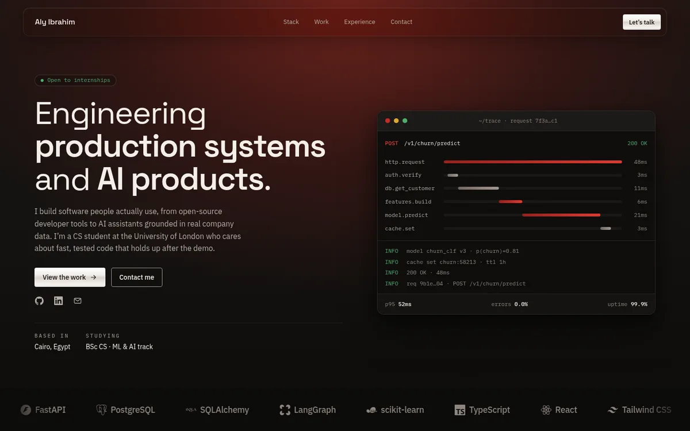

# Portfolio

My personal developer portfolio: a single-page React and TypeScript site where a
WebGL black hole swallows the headline and opens onto the projects, deployed to
Cloudflare Workers.

**Live site:** https://alyibrahim.dev/



## Highlights

- **Scroll-driven black hole.** A ray-traced WebGL shader, a lensed starfield and
  a headline that dissolves into grains, all driven by scroll position.
- **Experience as a star chart.** Each role is a star; select one to read its
  entry and see the projects it produced.
- **Accessibility built in.** Semantic landmarks, keyboard-operable stars with
  `aria-pressed`, and a `prefers-reduced-motion` mode that shows a still hero.
- **Prerendered.** The build renders the page to static HTML and the browser
  hydrates it, so search engines and first paint get the full content.
- **Deployed on every push.** Cloudflare Workers Builds lints, tests and builds before it
  publishes, so a broken commit never reaches the live site.

## Stack

React 19 · TypeScript 5.9 · Vite 7 · Vitest · ESLint · Cloudflare Workers

## Getting started

Requires Node.js 20.19+ or 22.12+ (the version Vite 7 needs).

```bash
npm install
npm run dev      # http://localhost:5173
```

## Scripts

| Command | What it does |
|---|---|
| `npm run dev` | Start the dev server |
| `npm run build` | Typecheck, build to `dist/`, then prerender the page into `dist/index.html` |
| `npm run preview` | Build, then serve `dist/` through the Worker runtime, with the real headers and 404 page. It does not pick up later builds while running on a Windows drive under WSL (`/mnt/…`), so stop it and run it again after a change |
| `npm run lint` | Lint `src` and the Vite config |
| `npm run test` | Run the tests in watch mode |
| `npm run test:run` | Run the tests once (used by the deploy build) |

## Project structure

```
DESIGN.md          Voice, tokens, motion and components of the page
docs/              React implementation standards
src/
  components/      atoms → molecules → organisms → templates
  data/            All page content in one place
  hooks/           Black hole, star sky, copy button, reduced motion
  lib/             Canvas and WebGL code with no React
  pages/           PortfolioPage
  styles/          horizon.css, the whole stylesheet
```

Page content (projects, milestones, skills) is data, not markup. To
change what the site says, edit `src/data/horizon.ts`; the profile and social
links are in `src/data/portfolio.ts`.

## Deployment

The site runs as a static-assets Cloudflare Worker named `portfolio`: there is
no Worker script, Cloudflare serves `dist/` directly. `wrangler.jsonc` holds
the Worker config: it serves only the `alyibrahim.dev` custom domain (no
workers.dev or preview URLs), and unknown paths get `public/404.html` with a
404 status.

`public/_headers` sets the response headers:

- A Content-Security-Policy that allows only the site's own files and Google
  Fonts. Adding another outside service (analytics, embeds, a new
  font host) means adding its origin there first. Inline scripts and styles
  are blocked, which is why the 404 page's styles live in `public/404.css`.
- `nosniff` and a `strict-origin-when-cross-origin` referrer policy.
- Caching: fingerprinted files in `/assets` for a year (immutable); icons, the
  manifest and `og.jpg` for a day; the page itself is revalidated on every
  load, so a deploy is visible at once.

Workers Builds deploys from the GitHub repo. Pushing to `main` deploys to
https://alyibrahim.dev/; other branches upload preview versions. The build is
configured in the Cloudflare dashboard under the Worker's Settings → Build;
the Node version comes from `.node-version`:

| Setting | Value |
|---|---|
| Build command | `npm run lint && npm run test:run && npm run build` |
| Deploy command | `npx wrangler deploy` |

## License

MIT — see [LICENSE](LICENSE).
